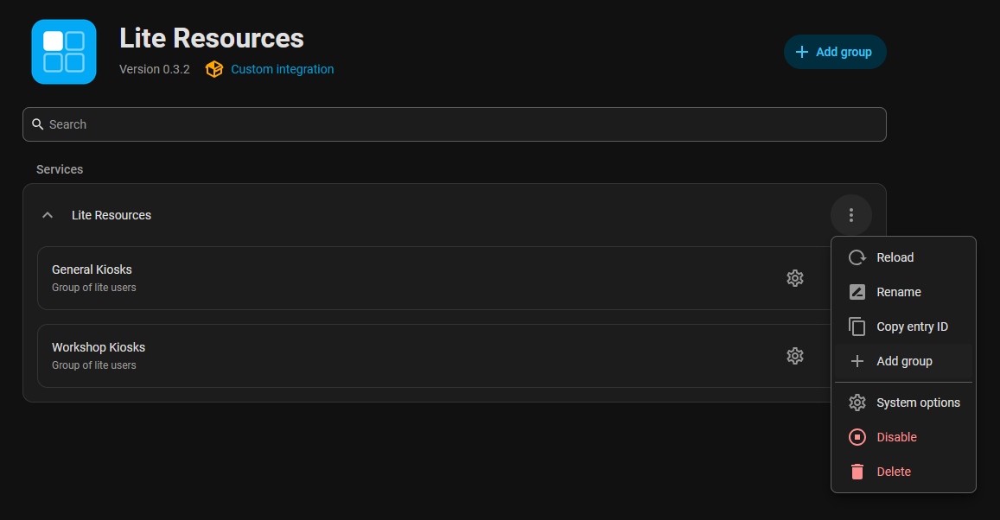

# ha-lite-resources

[](https://hacs.xyz/docs/faq/custom_repositories)
[](https://github.com/ColColonCleaner/ha-lite-resources/releases)
[](https://github.com/ColColonCleaner/ha-lite-resources/actions/workflows/validate.yaml)
[](LICENSE)

**Make Home Assistant dashboards fast on wall panels, old tablets and other low-powered devices, without changing anything for your phones and computers.**

## What this fork changes

This repository is a fork of version 0.2.1 of [evski/ha-lite-resources](https://github.com/evski/ha-lite-resources). The fork needs Home Assistant 2026.11 or later. On an older version, use the original, which needs Home Assistant 2025.1 or later. The [changelog](CHANGELOG.md) describes each change in full.

### Added features

- **Each set of devices can have its own dashboards.** A [group](#groups) holds the users that one set of devices logs in as, and the dashboards that those devices show.
- **The automatic selection of resources finds more cards.** The integration selects the resources of a group from the group's dashboards. This fork also finds the resource of a card type that a minified file registers in a form that the original could not read. It finds the resource of a card type that only a template names, such as a template that returns `{type: 'custom:...'}`. It also finds the resource of the custom integration WebRTC Camera, which the Advanced Camera Card needs for a WebRTC live view. With the original, you selected each such resource by hand under **Always include**.
- **The entities of a saved dashboard reach the open pages immediately.** When you save a dashboard or change a group, each open page of the group gets the states of the new entities without a page reload. Only a custom card type that is new to the dashboards needs one page reload.
- **An edit to the file of a YAML dashboard reaches the open pages when a page next opens that dashboard.** Home Assistant reads the file again at that time. Each open page of a group with that dashboard then gets the states of the new entities.
- **Entity and resource scans now have a timeout, and entity scans have retries.** An entity scan or a resource scan that hangs no longer blocks a page for more than 30 seconds. The integration retries a failed entity scan automatically, up to 6 times. Until the entity scan succeeds, a page that connects gets all states. Until the resource scan succeeds, a page that loads gets all resources.
- **The action `lite_resources.preview` shows what each group gets.** For each group, the action shows the resources and the entities that the group's pages get. It also shows the reason when entity filtering or resource filtering is off.
- **The group form validates its input.** The form rejects a group with no name, no user or no dashboard. It also rejects a user that is already in another group.
- **Unit tests and static checks cover the integration.** `ruff` runs the static checks, and `mypy` runs the type checks. One script runs the full validation before a commit, and a workflow makes each release.

### Corrections to the original

Version 0.2.1 of the original had these faults, and this fork corrects them.

- **Entity filtering survives a Home Assistant restart.** After a restart, a page can reconnect before Home Assistant sets the integration up. In the original, such a page got all states until its next page reload.
- **The area card, the scheduler card and the map card show their entities.** These cards find their entities themselves, and the stored dashboard does not list those entities. The original sent no states for them.
- **An entity that gets its first state late still shows on the page.** The original left out an entity that had no state yet when the page connected, such as an entity of an integration that starts slowly.
- **A dashboard that does not list its entities now shows all of them.** Home Assistant builds some dashboards automatically, such as the default dashboard before its first edit. For such a dashboard, the original sent the states of only two entities, `sun.sun` and `zone.home`, and the log said nothing. For a card that reads all entities, such as an energy card, the original sent no states for that card. This fork sends all states to the group of such a dashboard, and the log says why. See [When entity filtering is off for a group](#when-entity-filtering-is-off-for-a-group).
- **The choice `Overview (default)` now selects the dashboard that Home Assistant shows as its default.** This choice is in the option **Their dashboards**. When a dashboard with the URL path `lovelace` exists, Home Assistant 2026.11 shows that dashboard as its default, and the original read a different one.
- **The integration finds an entity in a multi-line template.** The original missed an entity ID that directly follows a line break, so that entity showed as unavailable.
- **One unreadable resource file no longer turns resource filtering off.** In the original, one unreadable resource file made the integration send every resource at each page reload, with an error in the log. A YAML dashboard whose file is missing did the same. Now an unreadable resource file counts as a resource that the integration cannot read, and the resource scan leaves out a dashboard that Home Assistant cannot load.
- **Only administrators can perform `lite_resources.preview`.** Its response names users, dashboards and entities, and the original let any user perform it.
- **You can save the group form after you delete a user or a dashboard in Home Assistant.** The original refused to save the form while it still held the deleted item.
- **Removing the integration restores all states immediately.** The original left entity filtering on for each open page until its next page reload.
- **This fork also corrects five smaller faults.** The integration no longer mistakes a resource on another server for a local file. **Always include** and **Always exclude** now match a resource by its server and its path, where the original matched by the path alone. The resource scan no longer mistakes unrelated text in a file for a card type. Each warning appears in the log once, and not at each page reload. A page that disconnects during an entity scan no longer leaves an unused event listener in Home Assistant until the next restart.

## What it does

Home Assistant sends every device the same thing. That is *every* custom card that you ever installed, and a live update for *every* entity in your home. It does so whether or not the device shows them. A phone shrugs that off. A wall panel with a slow chip spends its life downloading JavaScript that it never runs and processing updates for sensors that it never displays. You feel that as a laggy, stuttering dashboard.

This integration fixes that for the users that your slow devices log in as:

| | Without | With this integration |
|---|---|---|
| Resources that a page loads | all of them (25 files, ~9MB in one home) | only the ones that the device's dashboards use (2 in that home) |
| Entities whose states a page gets | every entity (2,955 in that home, ~28 updates a second) | only those on the device's dashboards (89 in that home) |
| Your phone, tablet, desktop | unchanged | unchanged |

<p align="center">
  
  
  
  <br><em>A Sonoff NSPanel Pro (480×480, Rockchip PX30) running a full Home Assistant dashboard with this integration.</em>
</p>

## Who is it for?

This integration is for anyone who runs a Home Assistant dashboard on hardware that struggles with it. For example:

- **Sonoff NSPanel Pro** (Gen 1 / Gen 2) and other Android in-wall switch panels (Tuya, Moes, Shelly Wall Display, "86-box" panels)
- **Amazon Fire tablets** (Fire 7 / HD 8 / HD 10) used as wall dashboards
- **Old iPads and Android tablets** given a second life on the wall
- **Raspberry Pi touchscreens** running a Chromium kiosk (Pi 3, Pi Zero 2 W, older Pi 4s)
- **Echo Show / Lenovo smart displays** running a browser or Fully Kiosk
- **Old phones** used as room remotes
- The **Home Assistant app from F-Droid** (the "minimal" Companion build without Google services), common on de-Googled and budget Android panels
- Anything shown through **Fully Kiosk Browser, WallPanel, View Assist / VACA, or the Home Assistant Companion app** on a modest device

The more custom cards you have installed and the more entities your home has, the bigger the difference.

### Running View Assist / VACA?

If you use [View Assist](https://github.com/dinki/View-Assist) with the **View Assist Companion App (VACA)** on a wall tablet or a wall panel, this integration is for you. VACA shows a Home Assistant dashboard, and the same modest device also does wake-word detection and audio. Every bit of CPU that the dashboard does not waste is CPU that the voice side gets. Add a group with the user that your VACA device logs in as, and with the View Assist dashboards of that device. Voice, timers and VACA's device controls are unaffected, because they do not use the dashboard's connection.

## How it works

This integration changes no file on disk, and it patches nothing in the frontend. For the users that you choose, it gives a different answer to two requests that the frontend sends to Home Assistant:

1. **Resources.** The frontend asks for the list of dashboard resources (`lovelace/resources`) each time the page loads. Lite users get only the resources that their dashboards use. The integration reads every dashboard that you select, whether or not another dashboard links to it. It collects every `custom:` card type in those dashboards, including the ones inside stacks, sections, conditional cards, pop-ups and features. Then it finds the resource files that register those card types. A resource file registers a card type when it gives the browser the code for that type. This work is the **resource scan**. The resource scan also recognises a bundle that builds its card types in code (`mushroom.js` provides `custom:mushroom-*-card`). For that, the whole file name must be the start of the card type. So `dreame-vacuum-card.js` does not count as the Mushroom vacuum card, and `lock-manager.js` does not count as the Mushroom lock card. Some resources change other cards or the page, and have no card type. Such a resource is a mod. The resource scan detects a mod from its key in the dashboard (`card_mod` → card-mod, `kiosk_mode` → kiosk-mode).
2. **States** (optional). The frontend subscribes to the state of every entity (`subscribe_entities`). For lite users, the integration filters that subscription to the entities that appear anywhere in their dashboards (cards, pop-ups, conditions, actions). It also keeps the members of each entity group, such as a light group, and each entity that you add under **Extra entities**. The work that finds those entities is the **entity scan**.

- The first answer is **resource filtering**, and the second is **entity filtering**.
- A **page** is one browser tab or app window that shows Home Assistant. Each page has its own connection to Home Assistant.

Everyone else gets Home Assistant's normal behaviour. When you remove the integration, everything is exactly as before. Each open page gets all states again immediately.

The resource scan also finds one resource that no card type names. In the Advanced Camera Card, a camera with `live_provider: webrtc-card`, or with the key `webrtc_card` and no live provider, needs a resource from WebRTC Camera. The integration sends that resource when a dashboard holds such a camera.

Some cards name no entity, and find their entities themselves. This integration sends the states of those entities too:

- The **area card** shows its area's camera, sensors, alerts and controls. Lite users get the entities that the card can show for that area.
- The **scheduler card** shows the schedules of the scheduler integration. Lite users get each schedule, and the entities that it controls.
- For a **map card** with `show_all`, lite users get each person, device tracker and zone. With `geo_location_sources`, they get each geo location entity.
- For the **updates card**, lite users get each update entity.
- Lite users get each zone when a dashboard holds a **tile card for a person**, a **tile card for a device tracker**, or a visibility condition on the user's **location**.
- Each lite user gets the person entity of that user. The frontend reads it for a visibility condition on the user's location, and for the user's picture.

Some custom cards select their entities in the browser, so the dashboard names none of them. Examples are `auto-entities` with a domain filter, and a card with a template that builds an entity ID from a variable. The entity list in the scheduler card's editor is a further example. For each of these, add the entities under **Extra entities**.

### When entity filtering is off for a group

Some dashboards do not list the entities that they show. Entity filtering is then off for each group with such a dashboard. The pages of that group get all states, as they do without this integration. The log gives the reason once, and `lite_resources.preview` gives it too. Resource filtering stays on for the group. These are the causes:

- A dashboard that Home Assistant does not store. Home Assistant generates such a dashboard in the browser. The default dashboard before its first edit is an example.
- A dashboard, a view or a section with a **strategy**. A strategy is a rule that the browser uses to build the cards, so the stored dashboard lists no card and no entity. The same is true for a section with a strategy that is in the sidebar of a view or inside another section.
- The **home-summary** card, the **energy**, **water** and **power** cards, and the badges **power-total**, **gas-total** and **water-total**. They take their entities from all states or from the energy settings.

**A device that gets all states carries the load that this integration exists to remove.** When you save one of these cards to a dashboard in a group, each open page of that group gets all states immediately. So check the log, or the preview action, after you change a dashboard in a group.

A custom strategy can make custom cards, and the stored dashboard then names none of them. Add the resource of each such card under **Always include**.

Two faults turn entity filtering off for a page that connects while the fault lasts. During such a fault, the entity scan cannot find the entities that the page needs. A page that is already open keeps its entities. The log gives each new reason once.

- A dashboard that Home Assistant cannot load, such as a YAML dashboard with a syntax error. The integration retries the entity scan automatically, about 10 seconds after each failure. After 6 failed retries, the automatic retries stop, and the log says so. The next entity scan then comes when you save a dashboard or change a group, or when a page of the group connects.
- An entity scan that takes longer than 30 seconds, for example when a YAML dashboard is on a share that does not answer. The integration stops waiting after 30 seconds, and the entity scan goes on. While it runs, the integration starts no other entity scan for the group, unless you change the group. When it ends, the integration starts a new one for the group.

When an entity scan next succeeds, entity filtering is on again for each open page of the group. Each page then gets the group's current entities.

## Groups

A group holds the users that one set of devices logs in as, and the dashboards that those devices show. The devices of each group get the resources and the states for the dashboards of that group. For example, the users of the wall panels in a workshop are one group. The user of the tablet in a kitchen is a second group, with a different dashboard. A user can be in only one group.

You do not list a group's resources. The resource scan finds them from the group's dashboards each time a page loads. The entity scan finds the group's entities each time a page connects. A page connects when it loads, and again after a lost connection.

### When a dashboard changes

Edit the dashboards as a normal user, not as a lite user. A lite user's browser loads only some of the custom cards, and the dashboard editor needs all of them. When you save a dashboard in a group, these things happen without a reload of the integration:

- Home Assistant sends the new dashboard to each open page. This is its normal behaviour.
- The entity scan runs again. Each open page of the group gets the states of the new entities immediately, and loses the entities that are no longer on the dashboards.
- A card type that is new to the dashboards loads on a page at the next reload of that page. The browser asks for the resource list only when the page loads, so the card shows an error on the page until then.

A change to a group, such as a new user or a new dashboard, reaches the open pages in the same way. A change to the entity, device or area registry does too, about 10 seconds after the change. Examples are a new schedule, and an entity that moves into the area of an area card.

Three changes do not reach an open page immediately. The first is a change to the file of a YAML dashboard. Home Assistant reads that file again only when something loads the dashboard. So the change reaches the open pages at the next such load. That load comes when a page opens the dashboard, or when you next save a dashboard or change a group. Each open page that belongs to a group with that dashboard then gets the states of the new entities.

The second is a new member of a light group. The third is a new entity that an existing schedule controls. Both reach a page at the next reload of that page, or when you next save a dashboard or change a group.

### After a Home Assistant restart

A page reconnects within seconds of a restart. Home Assistant sets up a custom integration a few seconds later, so the page's first state subscription is for all states. When Home Assistant sets the integration up, the integration finds that subscription and filters it. The page then drops the entities that the dashboards of its group do not show, and it keeps its connection.

To find that subscription, the integration reads internals of Home Assistant 2026.11. If a later version changes those internals, the log holds a warning. A page that connected before the setup then keeps all states until it next reconnects. If the log holds that warning, reload the page on each device after each restart.

One fault remains, and it is not in this integration. After a restart, a card with a camera can fail to show the camera until a page reload. In one home, a page asked for its cameras 9 seconds after the restart, and Home Assistant answered `Camera not found`, because the camera integration was not ready. So let each device reload its page at an interval, for example with the reload timer of its kiosk browser.

## Install

This integration needs Home Assistant 2026.11 or later.

### Marketplace (recommended)

The Marketplace replaced HACS in Home Assistant 2026.11.

**If the original is installed, uninstall it first,** because both repositories install the same integration folder. Open **Settings → Marketplace**, and open `evski/ha-lite-resources` there. Select the three-dot menu (⋮) in the upper-right corner, then **Uninstall**, then **Delete and uninstall**. That also deletes the original's configuration, so write down its users and its dashboards first. You enter them again as a group in [Configuration](#configuration). A manual install keeps the configuration, as [Update from 0.2.x](#update-from-02x) describes.

Follow these steps:

1. Open **Settings → Marketplace**.
2. Select **Add from link** in the upper-right corner.
3. Under **GitHub link**, enter `https://github.com/ColColonCleaner/ha-lite-resources`, and select **Add**. If the Marketplace asks you to connect GitHub, do that first.
4. Select **Lite Resources** in the Marketplace's list of repositories. Then select **Install**, and **Install** again in the dialog.
5. Restart Home Assistant. A repair under **Settings → System → Repairs** asks for the restart, and you can restart from that repair.

To update later, open the repository in the Marketplace and install the new version, then restart Home Assistant.

### Manual

Download the source code of the newest [release](https://github.com/ColColonCleaner/ha-lite-resources/releases), and unpack it. Copy its folder `custom_components/lite_resources` into your `config/custom_components/` folder and restart Home Assistant.

## Configuration

Follow these steps:

1. Open the dialog that adds the integration, in one of two ways:
   - Open **Settings → Devices & services**, select **Add integration**, search for **Lite Resources**, and select it.
   - Select this button: [](https://my.home-assistant.io/redirect/config_flow_start/?domain=lite_resources)
2. The dialog has no settings, and its text names the next step. Select **Submit**, and close the dialog that confirms the new entry.
3. Open **Settings → Devices & services → Lite Resources**. It shows the entry **Lite Resources**.
4. Select **Add group**. It is in two places there: the button in the upper-right corner, and the three-dot menu (⋮) at the right of the entry **Lite Resources**.
5. Fill in the form with the options in the table below, and select **Submit**. The group then shows as a row below the entry.
6. Repeat steps 4 and 5 for each further set of devices.
7. Reload the page on each device.

<p align="center">
  
  <br><em>Settings → Devices & services → Lite Resources, with two groups. The entry's three-dot menu is open.</em>
</p>

| Option | What to choose |
|---|---|
| **Group name** | A name for the set of devices, such as *Workshop kiosks*. |
| **Lite users** | The users that the slow devices of this group log in as. Give each device a Home Assistant user of its own. |
| **Their dashboards** | Every dashboard that those users open. |
| **Only send states their dashboards show** | On for a new group. It gives the biggest speed-up on slow devices. Turn it off when a device must show entities that you cannot list under **Extra entities**, for example when its user searches all entities. |
| **Extra entities** | Entities whose states the pages get although the dashboards do not name them. |
| **Include resources that the integration cannot read** | This integration cannot read a resource that another integration or another site serves (e.g. `/browser_mod.js`, `/webrtc/...`). On = the integration sends such a resource (recommended). Off = it does not send one unless it is under **Always include**. With the option on or off, the integration does not send a resource whose file has the name of a card that these dashboards do not use, such as `dreame-vacuum-card.js`. |
| **Always include** | Optional. Leave it empty, because the resources come from the dashboards. Add a resource only if a card fails to load, or if a theme needs a mod that no dashboard names. |
| **Always exclude** | Optional. Leave it empty in most cases. The integration never sends a resource that is here, even if a card seems to need it. Use this for a resource that another integration serves under a generic name, such as `/dreame_vacuum/frontend.js`, and that these dashboards do not use. **Always exclude** wins over **Always include**. |

### Change, rename or delete a group

Under **Settings → Devices & services → Lite Resources**, each group is a row below the entry.

- To change a group, select the cog icon (⚙) at the right of its row. The group's form opens. Change the options, and select **Submit**.
- To rename a group, select the three-dot menu (⋮) at the right of its row, then **Rename**. The form's option **Group name** does the same.
- To delete a group, select the three-dot menu (⋮) at the right of its row, then **Delete**. Its users then get Home Assistant's normal behaviour.

A change to the entities reaches the open pages immediately. A changed resource list reaches a page at its next page reload. The integration needs no reload, and Home Assistant needs no restart.

### Update from 0.2.x

A manual install over version 0.2.x of the original keeps the configuration. An install through the Marketplace does not, because the uninstall of the original deletes the configuration. With the manual install, the update moves the users and the dashboards of the 0.2.x configuration into one group named **Lite users**. Under **Settings → Devices & services → Lite Resources**, select the cog icon (⚙) at the right of that group's row, and give the group a new name. Then add the other groups with **Add group**.

Version 0.2.x cannot read the new configuration. To return to 0.2.x, first delete the entry **Lite Resources** under **Settings → Devices & services**. Then install version 0.2.x and add the integration again.

### Check what a group's pages get

1. Open **Settings → Tools → Actions**.
2. Enter `lite_resources.preview` under **Action**.
3. Select **Perform action**. The response shows below the button.

Only an administrator can perform this action, because the response names each user and each entity in the dashboards.

The response lists each group with its users. For each group it shows the resources that the group's pages get, the resources that they do not get, and each `custom:` card type for which the resource scan finds no resource file. When the group's option **Only send states their dashboards show** is on, it also shows the entities that the group's pages get. The response also holds these keys, which show what to check:

- `entities_not_filtered` and `resources_not_filtered` give the reason when entity filtering or resource filtering is off for a group.
- `guessed_types` holds each card type that no resource file registers in a way that the resource scan can read. For such a type, the integration sends a resource when its file meets two conditions. The file names the type in quotes, and it holds a registration that the resource scan cannot read. If the card still fails to load, add its resource under **Always include**.
- `excluded_without_element` holds each readable resource file in which the resource scan finds no card type. The integration does not send such a resource. Such a file either does its work with no card, as an icon set does, or it holds a card that the dashboards do not use, with a registration that the resource scan cannot read. Add the resource under **Always include** when a page needs it.
- `state_entities_without_state` holds each entity ID in the dashboards that has no state now. Entity filtering keeps those entity IDs, so a page gets each state when it comes. Such an entity ID belongs to an entity whose first state comes later, or it is a typing error in a card.
- `open_pages_with_filtered_entities` holds the number of open pages that have entity filtering now.

## FAQ

**Why is this not built into Home Assistant?**
The Home Assistant project designs the frontend so that any device can show anything instantly. Search, more-info dialogs and templates can reach every entity without asking first. That is the right default for phones and desktops. This integration is an opt-in trade-off for devices that only ever show one dashboard.

**Does it filter per device or per user?**
Per user. If you log in as a lite user on your phone, you get only the resources and the states of that user's group there too. So give each slow device a user of its own.

**Can two sets of devices have different dashboards?**
Yes. Add one group for each set. Each group gets the resources and the states for its own dashboards.

**Something shows "unavailable" or a card fails to load on the device.**
With entity filtering on, the integration does not send the states of entities that are not on the device's dashboards. Add them under **Extra entities**. If they are on a dashboard that the group does not hold, add that dashboard under **Their dashboards**. For a card that fails to load, perform `lite_resources.preview`, find the card type in the response, and add its resource under **Always include**. To keep a resource from a device that never uses it, add it under **Always exclude**.

**Does it affect voice assistants, automations, history or the companion app's sensors?**
No, as long as nothing but the device logs in as its lite user. The integration changes only the list of dashboard resources and the live state subscription, and only for lite users. The integration knows the user of a connection, but not the program that opened it. So another program that logs in as a lite user and asks for all states also gets only the entities on the group's dashboards. Give each device a user of its own, and use that user for nothing else.

**An administrator is a lite user. What changes?**
**Settings → Dashboards → Resources** then shows only the resources of the group, because it reads the filtered list of dashboard resources. Use another user to manage the resources.

**What happens if something goes wrong?**
The resource scan can fail with an error, or take longer than 30 seconds. The integration then sends the full resource list and writes the reason to the log. If the entity scan fails, a page that connects gets all states, and an open page keeps its entities. See [When entity filtering is off for a group](#when-entity-filtering-is-off-for-a-group) for what comes next.

Some gaps give no error. A card type that no resource file seems to register appears in the log once, and `lite_resources.preview` shows it. A resource such as an icon set, or a mod that only a theme uses, has no card type in a dashboard. The integration does not send such a resource until you add it under **Always include**.

## Contributing

Issues and pull requests are welcome. Please include your Home Assistant version and the output of `lite_resources.preview`.

Before each commit, run the full validation with one command:

```bash
python scripts/validate.py
```

The script runs the unit tests, the static checks, two type checks and hassfest, and it has no option that skips a check. It exits with 1 when a check fails or cannot run. The comment at the top of [scripts/validate.py](scripts/validate.py) names the two environment variables that the script reads.

hassfest is the tool that the Home Assistant project uses to validate an integration's manifest, translations and services. The project does not release it as a package. So the script runs the container image of the GitHub action `home-assistant/actions/hassfest` with Docker, on your machine or on a host that the script reaches with `ssh`. The script names the image by its digest, and the container gets no network and no volume. The script also fails for a hassfest warning, which hassfest itself lets pass.

To make git refuse a commit that fails a check, add a `pre-commit` hook to your clone that runs `python scripts/validate.py --tree-is-the-commit`. With that option, the script first compares the working tree with the staged changes. This check fails when a tracked file holds a change that is not staged, or when a file is untracked. The other checks read the working tree, so they check the commit only when the two are the same.

The Validate workflow also runs the HACS action, with which the HACS project validates a custom repository. That action reads the repository on GitHub, so it cannot run locally. The unit tests cover the three files that it checks: the brand icon, `hacs.json` and this README.

These commands run the script's checks one at a time from the root of the repository, apart from hassfest and the second type check:

```bash
python -m unittest discover -s tests
ruff check .
ruff format --check .
mypy
```

The tests need Python 3.12 or later and the package `voluptuous`. They run against stand-ins, so they need no Home Assistant installation. The static checks and the format check need ruff 0.17.5, and the type checks need mypy 2.4.1. Those are the versions that the Validate workflow installs. `ruff.toml` and `mypy.ini` hold the settings. To format changed code, run `ruff format .`.

The command `mypy` does not read Home Assistant, so its result is the same on every machine. It checks the calls inside the integration, and each name from Home Assistant has the type `Any` there. A second type check reads the types of Home Assistant from the source of its core. It needs a clone of that source at the tag of your Home Assistant version, and it runs no code from that clone:

```bash
git clone --depth 1 --branch 2026.11.3 https://github.com/home-assistant/core ../home-assistant-core
MYPYPATH=../home-assistant-core mypy --config-file mypy-homeassistant.ini
```

On Windows, set `MYPYPATH` with your shell's syntax. The Validate workflow runs both type checks.

### One word for one thing

This repository uses one word for one thing in each of its texts: this README, the changelog, the forms, the log and the comments. A second word for the same thing makes a reader ask if it is a second thing.

| The thing | Its word | Not for this thing |
|---|---|---|
| The hardware that shows a dashboard, such as a wall panel or a tablet | **device** | panel, screen, display |
| One browser tab or app window that shows Home Assistant, with its own connection | **page** | panel, device, client |
| A place in Home Assistant's settings, such as **Settings → Devices & services** | its path | page |
| A choice in a group's form | **option** | field |
| The name after `type:` in a card, such as `custom:mushroom-light-card` | **card type** | card name, element |
| An entity that holds other entities, such as a light group | **entity group** | group of entities |
| The browser loads the page again | **page reload** | refresh |
| Home Assistant loads the integration again | **reload of the integration** | restart |
| A user in a group | **lite user**, and a device **logs in** as that user | sign in |
| An entry of Home Assistant's list of dashboard resources | **resource**, and its file is the **resource file** | card file, script |
| The integration reads a group's dashboards to find the entities that they show | **entity scan** | scan alone |
| The integration reads a group's dashboards and resource files to find the resources that the dashboards use | **resource scan** | scan alone |
| The integration sends a page only the states of its group's entities | **entity filtering** | state filtering, narrow, limit |
| The integration sends a page only its group's resources | **resource filtering** | reduce, trim |
| The integration, in each of its versions, as the thing that acts | **this integration**, or `ha-lite-resources` | its display name, which stands only where a step names what Home Assistant shows |
| The version of the integration in this repository, where a text compares it with the original | **this fork** | this integration |
| A defect | **fault**, and a change **corrects** it | issue, bug |
| An entry of the issue list on GitHub | **issue** | |
| The version of the integration in the repository `evski/ha-lite-resources` | **the original** | upstream |
| Home Assistant sets the integration up | the integration's **setup** | start |
| What the user entered for the integration | **configuration** | setup |
| The checks before a commit | **validation**, with a **check** as one part of it | |

`scan` and `log` are nouns only. A word that does not explain itself gets a few words that say what it is, at its first use in a section.

## Releasing

Each version has a release on GitHub. Its tag is `v` plus the manifest's version, such as `v0.3.9`. Home Assistant shows that tag as the integration's version. For a repository with no release, Home Assistant shows a commit hash.

1. Set `version` in `custom_components/lite_resources/manifest.json` to the new version. Give `CHANGELOG.md` an entry for that version, and leave its section `Unreleased` empty. Add each new feature, and each correction to the original, to the section [What this fork changes](#what-this-fork-changes).
2. Run `python scripts/validate.py`. When each check passes, commit, and push the commit to `main`.
3. Run `python scripts/release_notes.py` with the tag, such as `python scripts/release_notes.py v0.3.9`. It prints the notes of the release, or it says why the tag is wrong.
4. Make the tag on that commit, and push it:

```bash
git tag v0.3.9
git push origin v0.3.9
```

The workflow `Release` then runs `scripts/release_notes.py` on GitHub and makes the release, with the changelog entry of the version as its notes. A tag that the script refuses gets no release.

If a run fails for a cause in the workflow, correct the workflow on `main`. Then start the workflow `Release` by hand in the `Actions` tab, and give it the tag. For a cause in the tagged commit, make a new version. In your own fork of this repository, GitHub runs no workflow until you enable GitHub Actions in the `Actions` tab.

Never move a tag that has a release, because Home Assistant installs by the tag. For a correction, make a new version.

## License

[MIT](LICENSE)
